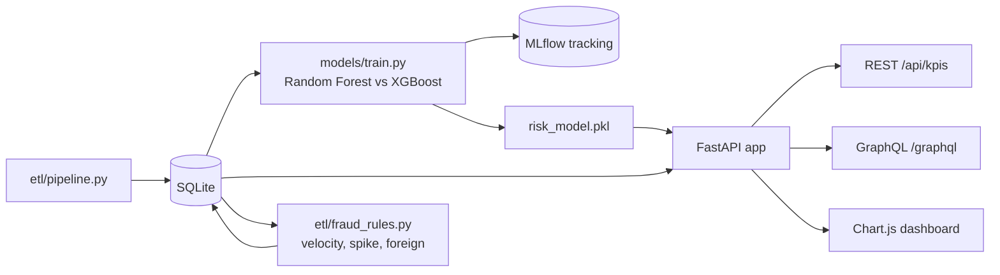
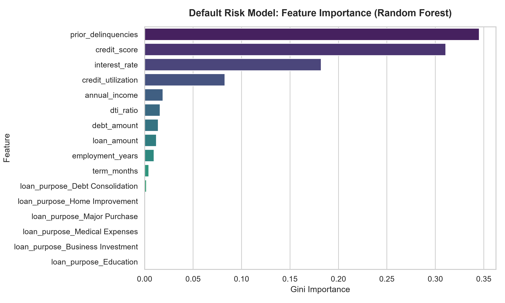

# FinTech Credit Risk & Fraud Command Center

[](https://github.com/Deshraj-Jogiya/FinRisk-Analytics-Pipeline/actions/workflows/ci.yml) 

An end-to-end credit-risk pipeline: ETL into SQLite, a Random Forest and an XGBoost model compared in MLflow, rule-based fraud flags, and a
FastAPI service with REST and GraphQL endpoints behind a Chart.js dashboard.

## Highlights

- **Default prediction:** both models predict whether a loan defaults, from credit score, income, tenure, debt, late-payment history,
  credit utilization and the loan's terms. The underwriting decision and the simulator's true default probability are kept out of
  the features (the first is a rule over the same inputs, the second is the answer key).
- **Model comparison:** on a held-out 20% of 10,586 loans, the Random Forest reaches ROC AUC 0.92 and **93.4% precision** when declining
  applications it scores at 80% or more likely to default (34% of defaults caught, 8.6% of applications declined); XGBoost reaches
  91.3% precision with 44.6% recall. The Random Forest goes to production; both runs are tracked in MLflow, and CI checks they were
  logged.
- **Low-latency API:** `POST /api/predict` scores an application with a median of 67 ms (95th percentile 85 ms, 200 calls on a laptop);
  the model is loaded once and cached, and `tests/test_risk_api.py` fails if the median reaches 100 ms.
- **Fraud rules:** `etl/fraud_rules.py` flags card transactions from the amount, time, location and customer only: a velocity rule
  (5 or more charges inside 10 minutes), an amount-spike rule (over 7 times the customer's median) and a foreign-location rule.
  Scored against the simulator's planted fraud, which the rules never read: the velocity rule caught all 1,110 card-testing
  charges with no false alarms; foreign-location alerts are 29.6% fraud; amount spikes alone are 1% fraud, because large
  purchases in this data are mostly legitimate, so they serve as a review signal. Together the rules catch every planted fraud
  case (2,591) at 25.8% precision. Results are written to `models/fraud_rule_metrics.csv`.
- **GraphQL layer:** a Strawberry GraphQL schema serves customer and loan data from the same database as the REST endpoints.
- **Dashboard:** KPIs and fraud anomalies in Chart.js.

## Architecture





## Stack

Python, FastAPI, scikit-learn, XGBoost, MLflow, Strawberry GraphQL, SQLite, Chart.js, pytest, GitHub Actions.

## Run it

```bash
pip install -r requirements.txt
python etl/pipeline.py
python models/train.py
python -m uvicorn api.app:app --port 8000      # then open http://127.0.0.1:8000
python -m pytest tests/ -v
```

## Data

All data is generated by `etl/pipeline.py` (`generate_mock_data()`, fixed random seed): 12,500 synthetic customers, 10,586 loan
applications and 345,524 card transactions, including card-testing bursts (6 to 10 small charges 20 to 90 seconds apart)
planted for about 1% of customers. Each loan's default is drawn from a probability that rises with lower credit
scores, more late payments, higher utilization and DTI, and falls with income and job tenure, giving a 23.4% default rate, similar
to a subprime lender's book. No real customer data is used.
