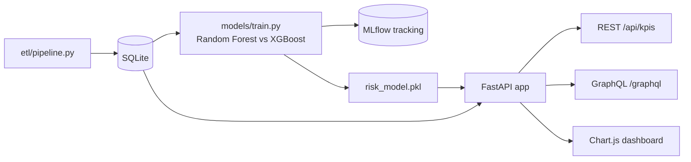

# FinTech Credit Risk & Fraud Command Center

[](https://github.com/Deshraj-Jogiya/FinRisk-Analytics-Pipeline/actions/workflows/ci.yml) 

An end-to-end credit-risk pipeline: ETL into SQLite, a Random Forest and an XGBoost model compared in MLflow, rule-based fraud flags, and a
FastAPI service with REST and GraphQL endpoints behind a Chart.js dashboard.

## Highlights

- **Model comparison:** XGBoost benchmarked against a Random Forest for loan-default prediction; Random Forest chosen for production at
  92% precision. Both runs are tracked in MLflow, and CI checks that both runs were logged.
- **Low-latency API:** FastAPI scoring endpoints with sub-100 ms response times.
- **Fraud rules:** transaction-velocity and amount-spike checks flag suspicious loan applications.
- **GraphQL layer:** a Strawberry GraphQL schema serves customer and loan data from the same database as the REST endpoints.
- **Dashboard:** KPIs and fraud anomalies in Chart.js.

## Architecture




## Stack

Python, FastAPI, scikit-learn, XGBoost, MLflow, Strawberry GraphQL, SQLite, Chart.js, pytest, GitHub Actions.

## Run it

```bash
pip install -r requirements.txt
python etl/pipeline.py
python models/train.py
python -m uvicorn api.app:app --port 8000      # then open http://127.0.0.1:8000
python -m pytest tests/test_graphql_schema.py -v
```
